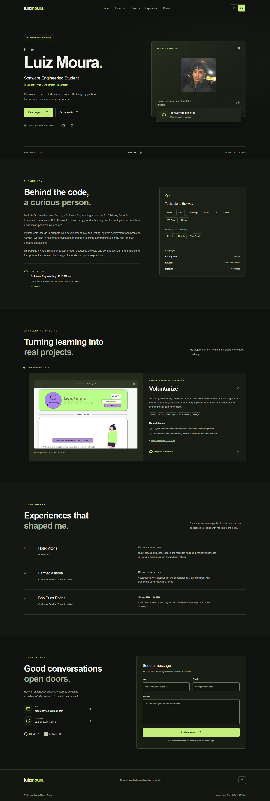
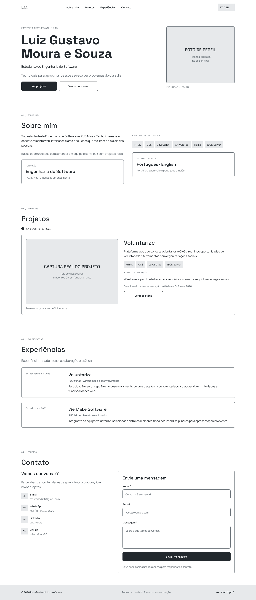
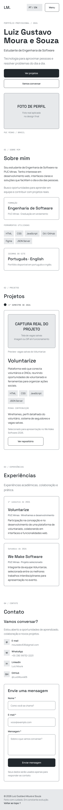
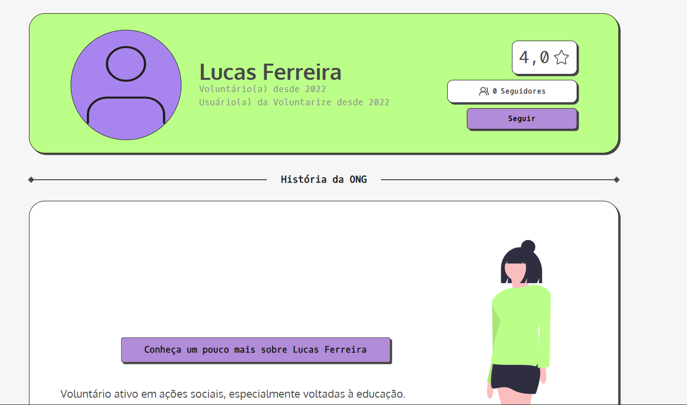

# Luiz Moura · Portfólio Profissional

## Apresentação pessoal

Olá! Sou **Luiz Gustavo Moura e Souza**, estudante de Engenharia de Software na **PUC Minas**, campus Coração Eucarístico, em Belo Horizonte. Desenvolvi este portfólio como parte da disciplina de **Desenvolvimento e Integração de Aplicações Web (DIAW)**, com o objetivo de apresentar minha trajetória, experiências, habilidades e projetos.

Tenho interesse em suporte técnico, desenvolvimento web, QA e testes, implantação de sistemas e resolução de problemas. Estou construindo minha base técnica por meio de projetos acadêmicos e aprendizado contínuo, trazendo também o que aprendi com atendimento ao público: ouvir, comunicar com clareza e buscar soluções.

**[Acessar meu portfólio](https://portfolio-eta-lyart-an0rd3myb7.vercel.app)** · [GitHub](https://github.com/LuizMoura06/Portfolio) · [Figma](https://www.figma.com/design/huHP7HxJKAxqY34czJmvPf)

## Sobre o projeto

O portfólio reúne minha formação, ferramentas de trabalho, experiências profissionais, contribuições em projetos e formas de contato em uma aplicação web responsiva, disponível em português e inglês.

A identidade visual usa tons de grafite e verde-lima, com navegação por seções e uma apresentação direta do conteúdo. O frontend e a API de contato estão no mesmo projeto Next.js, hospedado na Vercel.

Este trabalho corresponde ao **LAB01 — Portfólio Profissional**, da disciplina DIAW, ministrada pelo **Prof. Dr. João Paulo Aramuni**. A documentação segue as seções pertinentes do [template oficial de README](https://github.com/joaopauloaramuni/desenvolvimento-e-integracao-de-aplicacoes-web/blob/main/TEMPLATES/template_README.md). A conferência dos requisitos está em [docs/REQUISITOS.md](docs/REQUISITOS.md).

## Funcionalidades

- **Apresentação e Sobre Mim:** minha foto, formação, interesses, ferramentas e idiomas.
- **Português e inglês:** tradução da navegação, textos, formulário, validações e feedbacks, sem recarregar a página. A preferência é mantida entre visitas.
- **Navegação por seções:** cabeçalho fixo, links de âncora, indicação da seção atual e menu móvel que fecha após a seleção.
- **Timeline dinâmica de projetos:** conteúdo gerado a partir de dados, em ordem do mais antigo ao mais recente, com tecnologias, imagem real e repositório.
- **Experiências profissionais:** informações organizadas sobre meu trabalho no Hotel Vitória, na Farmácia Inova e na Bob Duas Rodas.
- **Contatos diretos:** e-mail, WhatsApp, GitHub e LinkedIn.
- **Formulário de contato:** validações no cliente e no servidor, envio por Resend, prevenção de envios simultâneos e estados de processamento, sucesso e falha.
- **Responsividade e acessibilidade:** layout para diferentes telas, HTML semântico, labels, texto alternativo, foco visível, navegação por teclado e respeito à preferência de movimento reduzido.
- **Compartilhamento:** título, descrição, imagem Open Graph e favicon.

## Tecnologias e bibliotecas utilizadas

| Tecnologia / biblioteca | Versão de referência | Aplicação no projeto |
| --- | --- | --- |
| Next.js | 16.4.2 | App Router, renderização, metadata e API de contato |
| React / React DOM | 19.3.1 | Componentes e interações da interface |
| TypeScript | 6.0.3 | Tipagem do código e dos dados |
| Tailwind CSS | 4.3.3 | Base de estilos, com CSS para layout e responsividade |
| Lucide React | 1.61.0 | Ícones da interface |
| React Hook Form | 7.90.0 | Estado e submissão do formulário |
| @hookform/resolvers | 5.9.2 | Integração entre o formulário e o schema |
| Zod | 4.6.7 | Validação compartilhada entre cliente e servidor |
| Resend | 6.34.1 | Envio de e-mail pelo backend |
| ESLint | 9.39.5 | Análise estática do código |
| Playwright | 1.64.1 | Testes de interface e responsividade |
| Node Test Runner + tsx | Node.js / 4.23.15 | Testes de schema, API e ordenação da timeline |
| Git / GitHub | — | Versionamento e hospedagem do código |
| Figma | — | Wireframes e prototipação |
| Vercel | — | Hospedagem e deploy contínuo |

As dependências completas estão em [package.json](package.json), e as versões reproduzíveis estão registradas em [package-lock.json](package-lock.json). O projeto não utiliza banco de dados nem exige autenticação dos visitantes.

## Demonstração visual do site

As capturas abaixo mostram a aplicação em funcionamento. Elas estão armazenadas no próprio repositório em `docs/screenshots`.

### Site desktop em português


### Site mobile em português


### Site desktop em inglês



## Wireframes e prototipação no Figma

### Wireframes — Planejamento da Interface

Planejei a organização das seções e a hierarquia do conteúdo antes da implementação. Os wireframes abaixo registram as propostas de navegação e distribuição dos elementos em telas desktop e mobile.

| Wireframe Desktop — 1440px | Wireframe Mobile — 390px |
| --- | --- |
|  |  |

O [protótipo completo no Figma](https://www.figma.com/design/huHP7HxJKAxqY34czJmvPf) inclui versões **desktop, tablet e mobile**, além das interfaces em **português e inglês**. O arquivo reúne wireframes, design final e componentes de referência para a implementação.

## Projeto em destaque: Voluntarize

O **Voluntarize** é um projeto acadêmico desenvolvido em equipe na PUC Minas, no primeiro semestre de 2026. A aplicação aproxima pessoas interessadas em voluntariado de ONGs e oportunidades de participação em ações sociais.

O projeto reúne busca de oportunidades, perfis de voluntários e organizações e conexões entre os participantes. As tecnologias utilizadas incluem **HTML, CSS, JavaScript, JSON Server e Node.js**.

Minha participação incluiu ajustes no layout e nas interações da visualização detalhada de voluntários, além da implementação do sistema de seguidores entre ONGs e voluntários. As contribuições podem ser consultadas nos commits:

- [Ajustes na visualização de voluntários](https://github.com/ICEI-PUC-Minas-PMGES-TI/pmg-es-2026-1-ti1-0438100-equipe-voluntarize/commit/8b20ebf2dca2a7281cb08cbe9ec3be914ca9de38).
- [Implementação do sistema de seguidores](https://github.com/ICEI-PUC-Minas-PMGES-TI/pmg-es-2026-1-ti1-0438100-equipe-voluntarize/commit/4da73a24731a582468b0d96f73a8843aeb6d603f).



[Acessar o repositório do Voluntarize](https://github.com/ICEI-PUC-Minas-PMGES-TI/pmg-es-2026-1-ti1-0438100-equipe-voluntarize). A aplicação e suas imagens são resultado do trabalho da equipe; os créditos e as fontes estão em [docs/ASSETS.md](docs/ASSETS.md).

## Arquitetura e estrutura de pastas

A aplicação utiliza o **App Router do Next.js**, com componentes de interface separados dos dados e das traduções. A timeline lê `projects.ts` e ordena os itens por data sem modificar o array original, permitindo adicionar novos projetos à mesma estrutura.

O formulário compartilha o schema Zod com o backend. O fluxo de envio é:

**Visitante → React Hook Form + Zod → POST /api/contact → validação no servidor → Resend → meu e-mail.**

O servidor mantém o destinatário fixo, usa o e-mail do visitante em `replyTo` e envia a mensagem como texto simples. A API rejeita dados inválidos, JSON malformado, payload excessivo, honeypot preenchido e requisições de outra origem. As credenciais permanecem no servidor; as mensagens não são armazenadas pela aplicação.

```text
Portfolio/
├── docs/
│   ├── figma/                       # Wireframes desktop e mobile
│   ├── screenshots/                 # Capturas reais da aplicação
│   ├── ASSETS.md                     # Fontes e créditos
│   ├── REQUISITOS.md                 # Conferência do LAB01
│   └── TESTES.md                     # Evidências de validação
├── public/images/                   # Minha foto e imagens do Voluntarize
├── src/
│   ├── app/
│   │   ├── api/contact/route.ts      # Validação e envio de e-mail
│   │   ├── globals.css              # Identidade visual e breakpoints
│   │   ├── icon.svg
│   │   ├── layout.tsx
│   │   ├── opengraph-image.tsx
│   │   └── page.tsx
│   ├── components/
│   │   ├── brand-icons.tsx
│   │   ├── contact-form.tsx
│   │   └── portfolio.tsx
│   ├── data/
│   │   ├── experiences.ts
│   │   ├── profile.ts
│   │   └── projects.ts
│   └── lib/
│       ├── contact-schema.ts
│       └── translations.ts
├── tests/
│   ├── contact.test.ts
│   └── e2e/portfolio.spec.ts
├── .env.example
├── next.config.ts
├── playwright.config.ts
├── package.json
├── package-lock.json
└── STATUS.md
```

## Como instalar e executar localmente

Pré-requisitos: **Node.js 22 ou superior**, npm e Git. O ambiente de desenvolvimento utiliza Node.js 24.

```powershell
git clone https://github.com/LuizMoura06/Portfolio.git
cd Portfolio
npm ci
Copy-Item .env.example .env.local
npm run dev
```

Acesse [http://localhost:3000](http://localhost:3000). Para executar a versão de produção localmente:

```powershell
npm run build
npm run start
```

## Variáveis de ambiente

Use o arquivo [.env.example](.env.example) como referência e preencha `.env.local` para habilitar o envio de mensagens no ambiente local.

| Variável | Finalidade |
| --- | --- |
| `RESEND_API_KEY` | Chave de envio do Resend, utilizada apenas no servidor |
| `CONTACT_FROM_EMAIL` | Remetente autorizado pela conta Resend |
| `SITE_URL` | Origem pública da aplicação para os metadados de compartilhamento |

O destinatário das mensagens é **mouradev636@gmail.com**, definido no backend. O remetente `onboarding@resend.dev` permite o envio ao e-mail da própria conta Resend. Para utilizar outros remetentes ou destinatários, é necessário verificar um domínio no serviço.

`.env.local` está no `.gitignore` e não deve ser versionado. As credenciais não usam o prefixo `NEXT_PUBLIC_`. Na Vercel, as mesmas variáveis são configuradas no ambiente do projeto, sem incluir segredos no repositório.

## Testes e build

| Comando | Verificação |
| --- | --- |
| `npm run lint` | Análise estática com ESLint |
| `npm run typecheck` | Checagem dos tipos TypeScript |
| `npm test` | Schema, validações PT/EN, API e ordenação cronológica |
| `npm run build` | Compilação de produção do Next.js |
| `npm run test:e2e` | Navegação, idiomas, imagens, responsividade e formulário |

Os testes E2E utilizam **Microsoft Edge** instalado, com `channel: msedge`, e iniciam ou reutilizam a aplicação em `localhost:3000`. Para executá-los contra a versão publicada:

```powershell
$env:PLAYWRIGHT_BASE_URL='https://portfolio-eta-lyart-an0rd3myb7.vercel.app'
npm run test:e2e
```

A interface é verificada nas larguras **1440, 1024, 768, 390 e 360 pixels**. Os testes incluem carregamento das imagens, troca de idioma, navegação, ausência de overflow horizontal, validações e feedbacks do formulário.

O envio real foi validado em produção, com entrega confirmada pelo Resend ao meu e-mail. Os cenários automatizados de sucesso e falha usam respostas controladas para testar a interface sem disparar mensagens. Os registros de validação estão em [docs/TESTES.md](docs/TESTES.md).

## Hospedagem na Vercel

O portfólio está publicado em **[portfolio-eta-lyart-an0rd3myb7.vercel.app](https://portfolio-eta-lyart-an0rd3myb7.vercel.app)**.

O projeto utiliza o plano Hobby, com o repositório [LuizMoura06/Portfolio](https://github.com/LuizMoura06/Portfolio) conectado à branch `main`. Novos pushes nessa branch iniciam o redeploy automático.

A configuração utiliza o framework **Next.js**, a raiz do repositório e o comando `npm run build`. A API de contato é executada no servidor, portanto a aplicação não utiliza exportação estática. As variáveis de ambiente do Resend e a URL pública são configuradas no painel da Vercel.

## Contatos e autoria

**Luiz Gustavo Moura e Souza — Luiz Moura**

Engenharia de Software · PUC Minas, campus Coração Eucarístico

- [GitHub](https://github.com/LuizMoura06)
- [LinkedIn](https://www.linkedin.com/in/luiz-moura-8a0b58357)
- [E-mail: mouradev636@gmail.com](mailto:mouradev636@gmail.com)
- [WhatsApp: +55 38 99732-2223](https://wa.me/5538997322223)

A fotografia de perfil é minha imagem original. Os wireframes e o protótipo documentam o planejamento deste portfólio. O Voluntarize e suas capturas têm os créditos da respectiva equipe acadêmica. Não foi definida uma licença de redistribuição para este repositório.
