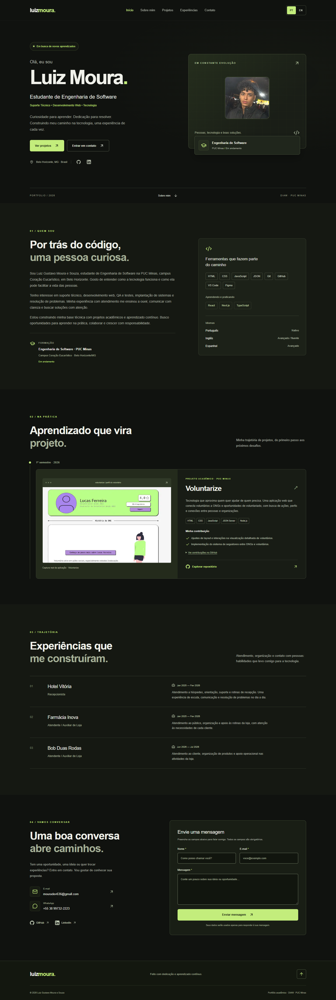
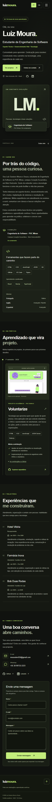

# Luiz Moura · Portfólio Profissional

Portfólio de **Luiz Gustavo Moura e Souza**, estudante de Engenharia de Software na PUC Minas, campus Coração Eucarístico. Desenvolvido para o LAB01 de **Desenvolvimento e Integração de Aplicações Web (DIAW)**, Prof. Dr. João Paulo Aramuni.

Apresenta formação, habilidades, experiências e contribuições acadêmicas verificadas, com interface PT/EN, navegação responsiva, identidade grafite/verde-lima e API de contato.

## Links úteis e status

- [Repositório público](https://github.com/LuizMoura06/Portfolio)
- [Figma oficial: wireframes, design final e componentes](https://www.figma.com/design/huHP7HxJKAxqY34czJmvPf/Luiz-Moura-%E2%80%94-Portf%C3%B3lio-Profissional-%C2%B7-DIAW)
- **Site na Vercel:** aguardando autorização e deploy; URL será adicionada após verificação real.
- [Voluntarize](https://github.com/ICEI-PUC-Minas-PMGES-TI/pmg-es-2026-1-ti1-0438100-equipe-voluntarize)
- [Checkpoint](STATUS.md) · [Requisitos](docs/REQUISITOS.md) · [Fontes e autoria](docs/ASSETS.md)

Adaptado do [template oficial do professor](https://github.com/joaopauloaramuni/desenvolvimento-e-integracao-de-aplicacoes-web/blob/main/TEMPLATES/template_README.md), com base no [PDF do LAB01](https://github.com/joaopauloaramuni/desenvolvimento-e-integracao-de-aplicacoes-web/blob/main/LABORATORIOS/LABORATO%CC%81RIO%2001%20-%20Portfo%CC%81lio%20Profissional.pdf).

## Sobre o projeto

Reúne a trajetória inicial de Luiz para professores, recrutadores e possíveis colaboradores. O conteúdo distingue experiências reais de atendimento, ferramentas já utilizadas e tecnologias em aprendizado. Não atribui senioridade ou experiências técnicas inexistentes.

## Funcionalidades

- Hero, Sobre Mim, Projetos, Experiências, Contato e footer.
- Header fixo, âncoras, indicação da seção, scroll suave e menu móvel que fecha após seleção e por Escape.
- PT/EN em toda a interface, sem recarregar, com preferência persistida e preservação da seção.
- Timeline de dados em ordem do mais antigo ao mais recente, inicialmente apenas Voluntarize.
- Imagem real e links para commits que comprovam as contribuições pessoais.
- Dados de experiências separados: Hotel Vitória, Farmácia Inova e Bob Duas Rodas.
- E-mail, WhatsApp, GitHub e LinkedIn clicáveis.
- Formulário com React Hook Form e Zod, validação no cliente/servidor, bloqueio de envios simultâneos e feedback acessível.
- Envio pelo Resend; sem credenciais, a API informa indisponibilidade (503), sem simular sucesso.
- Labels, foco visível, semântica, contraste corrigido dos inputs e redução de movimento.
- Metadata, imagem Open Graph gerada pelo Next.js e favicon LM.

## Tecnologias e dependências

Versões exatas reproduzíveis em package-lock.json.

| Camada | Dependências | Uso |
| --- | --- | --- |
| Aplicação | Next.js App Router, React, TypeScript | Renderização, interação e Route Handler |
| Estilos | Tailwind CSS 4, CSS | Tokens, layout responsivo e estados |
| Ícones | Lucide React | SVGs com rótulos acessíveis |
| Formulário | React Hook Form, @hookform/resolvers 5, Zod | Estado e schema compartilhado |
| E-mail | Resend | Envio exclusivamente no servidor |
| Qualidade | ESLint, TypeScript, Node Test Runner, tsx, Playwright | Análise estática, testes unitários/API e navegador |
| Hospedagem prevista | Vercel | Servidor Next.js e API de contato |

Não há banco de dados ou autenticação de visitantes. Mensagens não são armazenadas pela aplicação.

## Arquitetura frontend/backend

App Router fornece layout global e página. O componente Portfolio controla navegação e idioma. Projetos, experiências, perfil e traduções ficam em módulos separados.

**Visitante → formulário + Zod → POST /api/contact → Zod no servidor → Resend → mouradev636@gmail.com**.

O servidor fixa o destinatário e usa o endereço do visitante em replyTo. O e-mail é texto simples. São rejeitados JSON inválido, campos inválidos, payload excessivo, honeypot preenchido e origem diferente. Segredos não são enviados ao navegador. A resposta de sucesso exige ID de aceitação do provedor; recebimento na caixa de entrada é confirmado separadamente no teste real.

## Instalação e execução

Pré-requisitos: **Node.js 22+**, npm e Git. Ambiente utilizado: Node 24; prefira LTS suportado pela Vercel.

```powershell
git clone https://github.com/LuizMoura06/Portfolio.git
cd Portfolio
npm ci
Copy-Item .env.example .env.local
npm run dev
```

Abra [localhost:3000](http://localhost:3000). Neste computador, o checkout é G:\DIAW\Portfolio. Execute comandos nessa raiz, sem criar uma pasta aninhada.

### Variáveis de ambiente

| Variável | Finalidade |
| --- | --- |
| RESEND_API_KEY | API key de envio, exclusivamente no servidor |
| CONTACT_FROM_EMAIL | Remetente autorizado pelo Resend |
| SITE_URL | Opcional: origem HTTPS real após publicação, para metadata |

Destino fixo: **mouradev636@gmail.com**. Arquivo .env.local ignorado pelo Git. Nunca use NEXT_PUBLIC_ em credenciais.

Sem domínio próprio, onboarding@resend.dev só pode enviar para o e-mail da conta Resend. A conta deve corresponder ao destino acima. Para outros destinatários/remetentes, verifique um domínio. Consulte a [documentação Resend](https://resend.com/docs/send-with-nextjs).

### Comandos

```powershell
npm run lint
npm run typecheck
npm test
npm run build
npm run start
npm run test:e2e
```

Os testes E2E usam Microsoft Edge instalado (channel: msedge), contra localhost:3000 em produção. Em outro ambiente, instale Edge ou configure Chromium e execute npx playwright install chromium.

## Estrutura de diretórios

```text
Portfolio/
├── docs/
│   ├── ASSETS.md
│   ├── REQUISITOS.md
│   └── screenshots/
├── public/images/                  # Capturas reais do Voluntarize
├── src/
│   ├── app/
│   │   ├── api/contact/route.ts     # Validação e envio no servidor
│   │   ├── globals.css
│   │   ├── icon.svg
│   │   ├── layout.tsx
│   │   ├── opengraph-image.tsx
│   │   └── page.tsx
│   ├── components/
│   │   ├── contact-form.tsx
│   │   └── portfolio.tsx
│   ├── data/
│   │   ├── experiences.ts
│   │   ├── profile.ts
│   │   └── projects.ts
│   └── lib/
│       ├── contact-schema.ts
│       └── translations.ts
├── tests/contact.test.ts
├── tests/e2e/portfolio.spec.ts
├── .env.example
├── playwright.config.ts
├── package.json
├── package-lock.json
└── STATUS.md
```

Novos projetos entram em src/data/projects.ts com textos PT/EN e startDate. sortProjects ordena sem modificar o array original; o componente já suporta vários itens.

## Demonstração

Capturas reais geradas pela suíte de navegador:

| Desktop PT | Mobile PT |
| --- | --- |
|  |  |

[Desktop em inglês](docs/screenshots/desktop-en.png).

### Protótipo Figma

O arquivo oficial contém, conforme informado pelo autor, as páginas “01 — Wireframes”, “02 — Design final” e “03 — Componentes & implementação”. O MCP atingiu o limite do plano. As imagens dos wireframes ainda precisam ser exportadas e adicionadas; as capturas da implementação não substituem essa evidência.

## Testes

- Schema: normalização, nome vazio, e-mail inválido, quebra de linha, honeypot, tamanho e traduções.
- API: JSON inválido, tamanho, content type, origem e ausência de credenciais.
- Timeline: ordem cronológica e imutabilidade dos dados.
- Navegador: 1440, 1024, 768, 390 e 360 px, navegação, imagens, menu, PT/EN e validação.
- Capturas reais desktop/mobile. Resultados executados e limites atuais em STATUS.md.
- Respostas controladas podem testar feedbacks, mas não comprovam envio real. O teste de e-mail exige aceitação do Resend e confirmação de entrega.

## Deploy na Vercel

**Aguardando autorização explícita do autor.** Importar LuizMoura06/Portfolio, branch main, raiz do repositório, framework Next.js. Não fazer exportação estática: a API exige servidor.

1. Usar Node 24 LTS e os comandos padrão npm ci / npm run build.
2. Configurar RESEND_API_KEY e CONTACT_FROM_EMAIL no ambiente da Vercel.
3. Publicar, verificar a URL pública e testar navegação, mobile e envio real.
4. Definir SITE_URL com a origem real e atualizar este README com o link publicado.

Ao conectar deploy contínuo, pushes posteriores na main poderão publicar automaticamente.

## Autor

**Luiz Gustavo Moura e Souza — Luiz Moura**

- [GitHub](https://github.com/LuizMoura06)
- [LinkedIn](https://www.linkedin.com/in/luiz-moura-8a0b58357)
- [E-mail](mailto:mouradev636@gmail.com)
- [WhatsApp](https://wa.me/5538997322223)

## Créditos e licença

Voluntarize e suas imagens pertencem à equipe acadêmica. Contribuições pessoais têm evidências em docs/ASSETS.md. Conteúdo pessoal fornecido pelo autor. Nenhuma licença de redistribuição foi escolhida para o portfólio.
